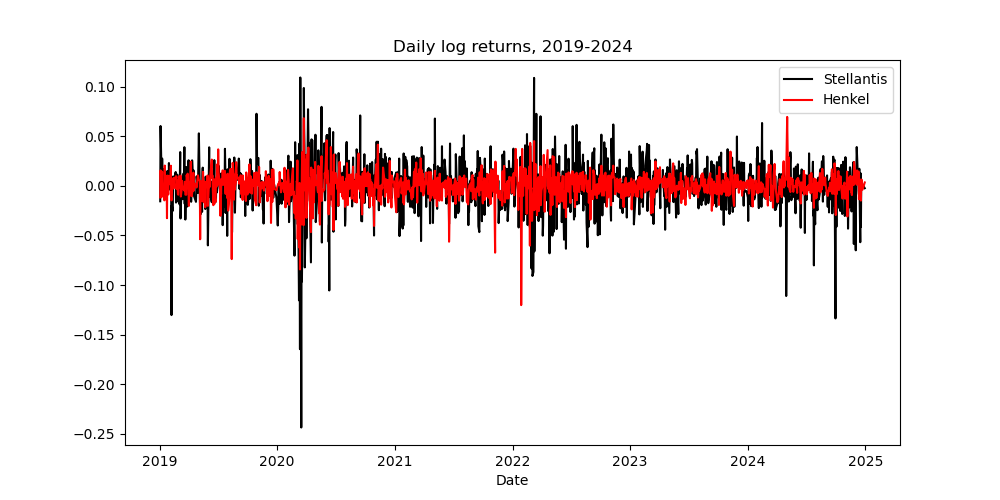
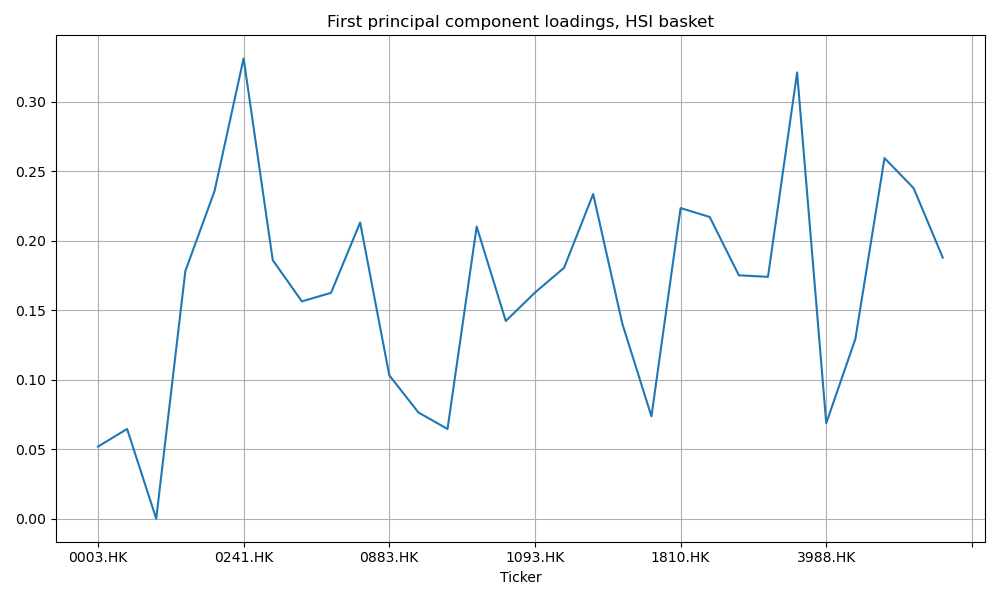
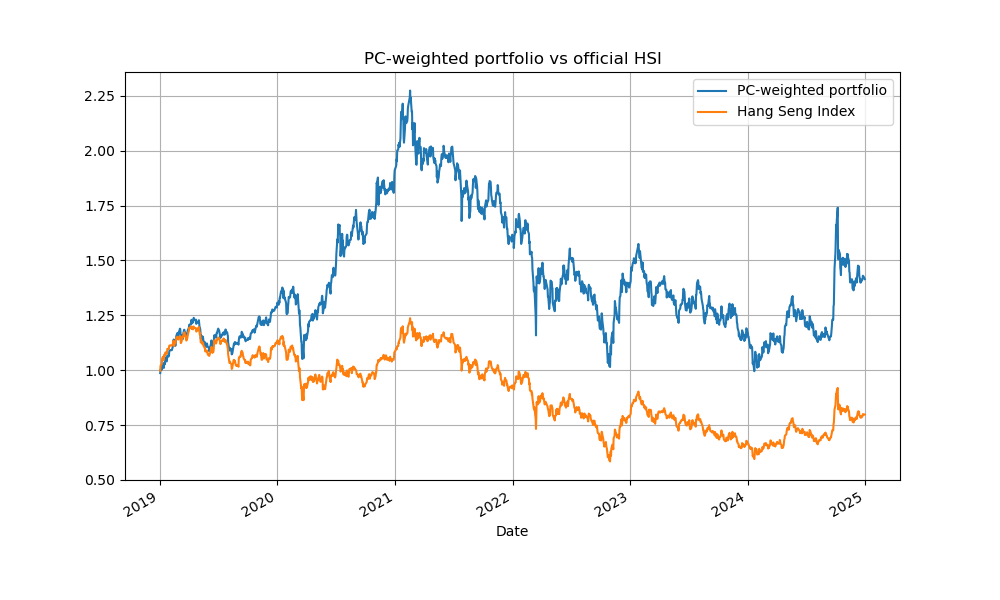
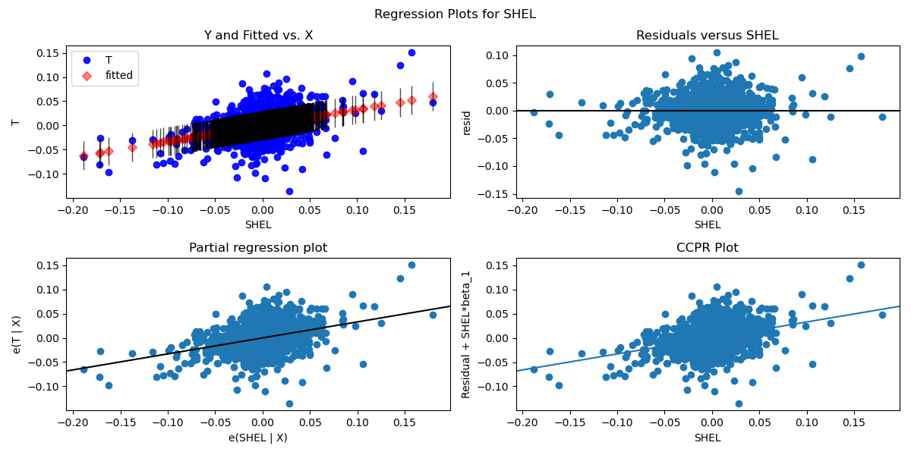

# Equity Returns, Risk Diagnostics, PCA & OLS Regression

**Author:** Antonio Rainis

**Course:** MSc Financial Data Science, UCD Smurfit Business School

## Executive summary

This notebook builds a small toolkit for comparing equity return series and applying two classic
techniques from empirical finance: **Principal Component Analysis (PCA)** for index decomposition
and **OLS regression** for cross-security dependence.

**Workflow**
1. Download and compare log returns for Stellantis (STLA) and Henkel (HEN3.DE).
2. Run standard risk diagnostics: descriptive statistics, correlation, distribution shape,
   stationarity (ADF), and outlier detection (boxplots + z-score filtering).
3. Decompose a basket of 30 Hang Seng Index constituents with PCA and build a
   first-principal-component-weighted portfolio, then compare it against the official HSI.
4. Fit an OLS regression of AT&T (T) returns on Shell (SHEL) returns and diagnose the residuals.

## Key findings

### 1. Stellantis is far more volatile than Henkel, and the two are only weakly correlated

- Stellantis is materially more volatile than Henkel (std. dev. ~2.5% vs ~1.3% daily), with a
  fatter tail on both sides of its return distribution (worst day ≈ -24% vs ≈ -12% for Henkel).
- Both return series are strongly stationary (ADF p-values ≈ 0).
- The two stocks show only a weak positive correlation (~0.34), so they offer meaningful
  diversification benefit if held together.

### 2. Chinese tech and consumer names drive the common factor in the Hang Seng basket

- The first principal component explains about **45%** of the variance in the basket, and every
  stock loads positively on it, so it behaves like a common "market" factor.
- **Alibaba Health (0241.HK)** and **Meituan (3690.HK)** load most heavily on it, followed by
  JD.com (9618.HK) and Alibaba (9988.HK): these names drive most of the common variance.
- The large banks (HSBC, Bank of China, ICBC, CCB), China Mobile and Hong Kong & China Gas load
  only weakly, so they move more independently of the common factor.
- Hang Seng Bank (0011.HK) failed to download from Yahoo Finance, so its loading is zero and the
  basket effectively contains 29 names.

### 3. The PC-weighted portfolio beat the official index by a wide margin

- A portfolio weighted by the (absolute) first-principal-component loadings returned roughly
  **+40%** cumulatively over 2019-2024, while the official HSI *lost* roughly **20%** over the same
  window.
- The portfolio more than doubled from its March 2020 low to its February 2021 peak, then gave
  back much of that gain over the following three years.
- This is a reminder that PC-based weighting is a statistical construct, not automatically a
  better investable strategy: it overweights the stocks that drive *variance*, and the divergence
  here is largely a function of which constituents were sampled.

### 4. Shell explains only a small share of AT&T's daily returns

- Shell explains only about **13.7%** of the variance in AT&T's daily returns (R² = 0.137,
  slope ≈ 0.33).
- The relationship is statistically real (p ≈ 0), but the residuals are non-normal (skew -0.25,
  kurtosis 10.3) and widely scattered, so it is far too noisy to be used as a standalone
  predictive signal.

## How to reproduce

Run all cells top to bottom. Requires an internet connection (Yahoo Finance via `yfinance`).
Chart PNGs are saved into a local `charts/` folder and CSV outputs into a local `excel/` folder as
each cell runs.
